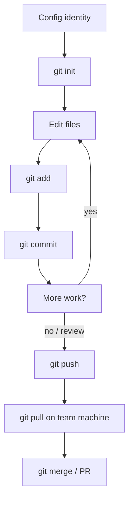

# 🔄 Git Command Sequence — The Real-World Workflow

> This file lists Git commands in the **exact order** they are used in a typical real-world workflow.
> Each command has a comment explaining what it does and **why** it is used at that point.
>
> 📋 Pair this with the [Cheat Sheet](./cheatsheet.md) for quick lookups.

---

## 🧩 1. Project Start (First Time Ever)

```bash
# 1. Set your identity — do this once per machine
git config --global user.name "Your Name"
git config --global user.email "you@example.com"

# 2. Create and enter the project folder
mkdir my-project
cd my-project

# 3. Initialize a new Git repository (creates .git/)
git init

# 4. Check the state — should say "No commits yet"
git status
```

---

## ✍️ 2. The Daily Save Loop (Edit → Add → Commit)

```bash
# 5. Make or edit your files
#    (edit index.html, style.css, ... in your editor)

# 6. See what changed
git status

# 7. Stage the files you want in this commit
git add .

# 8. Review exactly what is staged before committing
git diff --cached

# 9. Save a snapshot with a clear message
git commit -m "Add landing page header"

# 10. Look at your history
git log --oneline
```

> 🔁 **Repeat steps 5–10** throughout the day. Small, frequent commits beat rare huge ones.

---

## 🌿 3. Feature Branch Workflow

```bash
# 11. Start a new feature branch off main
git switch main
git switch -c feature/contact-form

# 12. Make changes, then commit them
git add .
git commit -m "feat: add contact form markup"

git add .
git commit -m "feat: style contact form"

# 13. When done, merge back into main
git switch main
git merge feature/contact-form

# 14. Delete the merged branch
git branch -d feature/contact-form
```

---

## ☁️ 4. Taking It Online (GitHub)

```bash
# 15. Add the remote (URL from GitHub -> Code -> HTTPS/SSH)
git remote add origin https://github.com/you/my-project.git

# 16. First push — set upstream so later pushes are simple
git push -u origin main

# 17. Future pushes (upstream already set)
git push
```

---

## 📥 5. Cloning an Existing Project

```bash
# 18. Copy a repo down to your machine
git clone https://github.com/you/my-project.git
cd my-project

# 19. Verify the remote is configured
git remote -v

# 20. Create your own branch and get to work
git switch -c your-name-changes
```

---

## 🤝 6. Collaboration — Keep in Sync

```bash
# 21. Before starting work, bring main up to date
git switch main
git pull

# 22. Start fresh feature work from the updated main
git switch -c feature/dark-mode

# ... work, add, commit ...

# 23. While you were working, others pushed — get their changes
git switch main
git pull

# 24. Merge their updates into your feature branch
git switch feature/dark-mode
git merge main

# 25. If a conflict appears: edit files, then re-add and commit
git add .
git commit -m "Merge main into feature/dark-mode"

# 26. Push your branch for review
git push -u origin feature/dark-mode
```

---

## 🔀 7. Open-Source Contribution (Fork Workflow)

```bash
# 27. Fork the project on GitHub first (click "Fork")
# 28. Clone YOUR fork, add upstream
git clone https://github.com/you/awesome-project.git
cd awesome-project
git remote add upstream https://github.com/original/awesome-project.git

# 29. Sync your main from upstream before starting
git fetch upstream
git switch main
git merge upstream/main
git push origin main

# 30. Create your change branch
git switch -c fix-typo

# 31. Commit and push your fix
git add .
git commit -m "docs: fix typo in README"
git push -u origin fix-typo

# 32. Open a Pull Request on GitHub
#     base: original:main  <-  compare: your:fix-typo
```

---

## 🕳️ 7b. Updating Your PR After Review

```bash
# 33. Teammates asked for changes? Make them and push
git switch fix-typo
#    (edit files)
git add .
git commit -m "refactor: address review feedback"
git push            # PR updates automatically

# 34. If the PR needs a fresh main, sync again
git fetch upstream
git merge upstream/main
git push
```

---

## 🚨 8. Fixing Mistakes (Undo & Recovery)

```bash
# 35. Discard uncommitted changes in ONE file
git restore mistake.txt

# 36. Un-stage a file (keep its changes)
git restore --staged mistake.txt

# 37. Undo the LAST commit but keep the changes
git reset --soft HEAD~1

# 38. Safely undo a commit ALREADY pushed — create an inverse commit
git revert a1b2c3d4
git push

# 39. Lost a commit? Check the reflog and fsck
git reflog
git fsck --lost-found

# 40. Park half-finished work to switch context fast
git stash
git stash pop
```

---

## 🏷️ 9. Releasing a Version

```bash
# 41. Tag a release point
git tag -a v1.0.0 -m "Release 1.0.0"

# 42. Push tags to the remote
git push origin v1.0.0
git push --tags            # push all tags

# 43. Show tags
git tag
```

---

## 🧼 10. End of Day / Cleanup

```bash
# 44. See everything that is happening
git status
git log --oneline --graph --all

# 45. Delete local branches that were already merged
git branch --merged
git branch -d feature/old-merged

# 46. Fetch and prune deleted remote branches
git fetch --prune

# 47. Housekeeping (compresses objects)
git gc
```

---

## 🗺️ The Full Sequence at a Glance



---

> 💡 **Pro Tip:** You rarely use *all* of these in one session. The daily core is:
> `git status` → `git add` → `git commit` → `git push` (and `git pull` when you start).
>
> ⚠️ **Golden rules:**
> - Never force-push to a shared branch.
> - Never `git reset --hard` without a backup.
> - Always `git pull` before you start new work.
