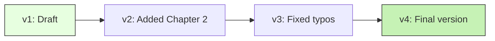
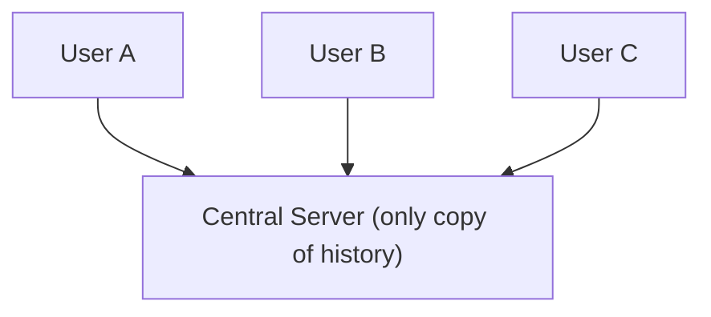
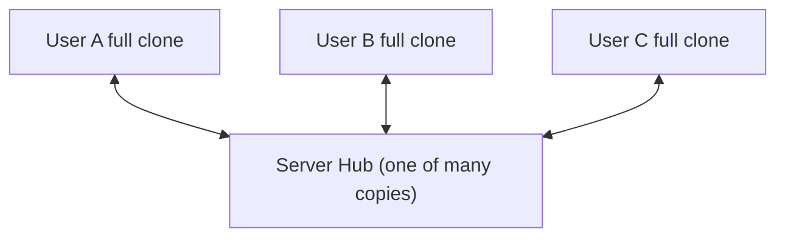

# Part 1: Introduction to Version Control

> **Level:** 🟢 Beginner ➡ 🔵 Expert
> **Goal:** Understand *why* version control exists, the two major types, and why Git wins.

---

## 1.1 What is Version Control?

**Version Control** (also called *Source Control* or *Revision Control*) is a system that **records changes to files over time**, so you can recall specific versions later.

- It keeps a **history** of every change you make.
- It lets you **go back in time** to any previous state.
- It allows **multiple people** to work on the same files without overwriting each other.
- Every project is a **repository** (or "repo" for short).

### Key Terms (bold = learn these)

- **Repository (repo):** The folder + hidden database where your project and its history live.
- **Commit:** A saved *snapshot* of your project at a point in time.
- **Version/Revision:** A specific recorded state of your project.
- **Working Copy:** The files you currently have open on your disk.

### Why do we need it? 🤔

Imagine writing a 300-page novel and losing 100 pages because you saved over them. Version control is the **undo button for your whole project**.



Each snapshot is preserved — you can jump to any point.

---

## 1.2 Centralized vs Distributed (CVCS vs DVCS)

### 🏛️ Centralized Version Control (CVCS)

One **central server** holds the entire history. Users check out files, edit, and check them back in.

- **Examples:** CVS, Subversion (SVN), Perforce.
- ✅ Simple to understand; one source of truth.
- ❌ **Single point of failure** — if the server dies, history is lost.
- ❌ **Must be online** to commit.



### 🌍 Distributed Version Control (DVCS)

Every user has a **full copy of the entire history** locally. The server is just one of many copies.

- **Examples:** Git, Mercurial.
- ✅ **No single point of failure** — every clone is a full backup.
- ✅ **Work offline** — commit locally, sync later.
- ✅ Fast — almost everything is local.



> 💡 **Pro Tip:** In Git, every developer has the *complete* history. This is why Git is called **"distributed"** — no central authority is required.

---

## 1.3 Why Git? (Benefits over other systems)

Git was created in 2005 by **Linus Torvalds** (the creator of Linux) after the Linux kernel team outgrew their existing tools. It is now the **industry standard**.

### The Big Benefits

- 🚀 **Speed** — Most operations are local, so they feel instant.
- 🔒 **Data Integrity** — Everything is checksummed (SHA-1); Git will *detect* any corruption or tampering.
- 🌿 **Powerful Branching** — Branches are cheap and lightweight; Git encourages branch-per-feature workflows.
- 💾 **Full Backups Everywhere** — Every clone contains the whole history.
- 🌐 **Free & Open Source** — Backed by the largest community and hosting platforms (GitHub, GitLab, Bitbucket).
- 🧠 **Staging Area** — Git lets you craft *exactly* what goes into each commit, unlike SVN.

### Git vs Others (quick table)

| Feature | SVN (CVCS) | Git (DVCS) |
|---------|-----------|------------|
| Full history on every machine | ❌ No | ✅ Yes |
| Work offline | ❌ No | ✅ Yes |
| Cheap local branching | ❌ Heavy | ✅ Lightweight |
| Integrity checking | ⚠️ Basic | ✅ Cryptographic |
| Popularity today | 📉 Declining | 📈 Industry standard |

---

## 🟢 Beginner Example — Saving Game Progress

Think of version control like **saving a video game**.

- You play for an hour, reach level 5, and press **Save** → that is a **commit**.
- You keep playing, mess up, and die. No problem — **Load Game** → you are back at level 5.
- Each save slot is a **branch**. You can try a risky path on a new save slot (branch) without destroying your main progress.

```bash
# Saving progress = committing
git add .
git commit -m "Level 5 completed"

# Load game = go back to a previous commit
git checkout <commit-id>
```

If you never saved (never committed), a crash means **game over forever**. 😱

---

## 🔵 Expert Example — Managing Microservices

Imagine you manage a **microservices platform** with 20 services:

- **Auth Service**, **Payments Service**, **Notifications Service**, and more, each in its own repository.
- Each service is developed by a **different team** at different speeds.

**Without version control:** deploying a new release of the platform becomes a manual coordination nightmare — who changed what, when, and did it break Payments?

**With Git:**
- Every service repo tracks its own history; `git log` answers *who/when/why* for any line.
- Teams use **feature branches** and **Pull Requests** so nothing lands in production unreviewed.
- Release managers **tag** stable versions (`v2.1.0`) so they can instantly roll back a broken deploy.
- **Git submodules** (or package registries) let each service pin the *exact* version of shared libraries it was built against.

```bash
# On the payments service, a team cherry-picks a hotfix to the release branch
git checkout release-2.1
git cherry-pick a1b2c3d4
git push origin release-2.1
```

> 💡 **Pro Tip:** In professional teams, `git blame` and `git log -p` are used daily to answer *"why does this line exist?"* — a superpower only version control gives you.

---

## ⚠️ Common Mistakes

- ❌ **Not committing often** — big, rare commits make history useless for debugging.
- ❌ **Committing secrets** (passwords, API keys) — they stay in history *forever*. Use `.gitignore` and secret scanners.
- ❌ **Assuming the server is the only copy** — in Git, *every* clone is a full backup. Do not delete clones casually.
- ❌ **Skipping commit messages** — `git commit -m "stuff"` is not helpful later.

---

## ✅ Key Takeaways

- Version control records **history**, enables **rollback**, and powers **collaboration**.
- **CVCS** = one central server; **DVCS** = every user has full history.
- **Git** is a distributed system that is fast, safe, offline-friendly, and the industry standard.
- Next, we will install Git and configure it on your machine.

---

## 📍 Next Steps

- ⏭️ Continue to **[Part 2: Getting Started with Git](./part-2-getting-started-with-git.md)** — install and configure Git.
- 📋 Need a command fast? Open the **[Cheat Sheet](./cheatsheet.md)**.
- 🔄 Want the full workflow at a glance? See the **[Command Sequence](./git-commands-sequence.md)**.
