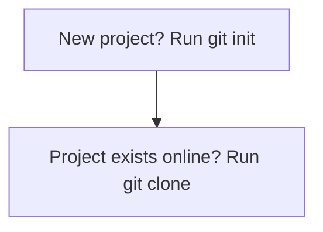

# Part 2: Getting Started with Git

> **Level:** 🟢 Beginner ➡ 🔵 Expert
> **Goal:** Install Git, configure your identity, and create your first repository.

---

## 2.1 Installing Git

### Windows 🪟

1. Download the installer from the [official Git website](https://git-scm.com/downloads).
2. Run the installer. Keep the default options (they are well chosen).
3. After install, open **Git Bash** (a Unix-like terminal bundled with Git).

### macOS 🍏

The easiest way is via **Homebrew** (a package manager):

```bash
# Install Homebrew first if you do not have it
/bin/bash -c "$(curl -fsSL https://raw.githubusercontent.com/Homebrew/install/HEAD/install.sh)"

# Then install Git
brew install git
```

> 💡 **Pro Tip:** Installing **Xcode Command Line Tools** (`xcode-select --install`) also installs Git on macOS.

### Linux 🐧 (Debian/Ubuntu)

```bash
sudo apt update
sudo apt install -y git
```

### Verify Installation (any OS)

```bash
git --version
```

You should see output like `git version 2.39.2` (or newer).

> ⚠️ **Warning:** If `git --version` fails, Git is not on your `PATH`. Re-check your installation steps.

---

## 2.2 Git Configuration (`git config`)

Git needs to know **who you are** — every commit is stamped with your identity.

### Level 1: Global Configuration (your whole machine)

```bash
git config --global user.name "Your Name"
git config --global user.email "you@example.com"
```

### View your configuration

```bash
git config --list
git config --list --global      # only global settings
git config user.name            # just one value
```

### The three config levels

| Scope | Command | Applies to |
|-------|---------|------------|
| **System** | `git config --system` | Every user on the machine |
| **Global** | `git config --global` | All repos of the current user |
| **Local** | `git config --local` (default) | Only the current repo |

> ⚠️ **Warning:** Your commit **email** is what appears publicly on GitHub. Consider using a *privacy-protected* email (GitHub provides a `noreply` alias) or a professional email.

---

## 2.3 Initializing a Repository (`git init`)

A **repository** is a folder Git is tracking. Creating one is instant:

```bash
mkdir my-first-repo
cd my-first-repo
git init
```

- This creates a hidden **`.git`** folder — the "brain" of the repo (we explore it in **[Part 8](./part-8-git-internals.md)**).
- Run `ls -a` and you will see `.git/` appear.

> ⚠️ **Warning:** Never run `git init` in your home folder or an entire drive. Keep one repo per project.

### Cloning vs Initializing

- **`git init`** → start a brand-new project locally.
- **`git clone`** → copy an *existing* project (more in **[Part 5](./part-5-introduction-to-github.md)**).



---

## 🟢 Beginner Example — First Repo Setup

You are creating your first ever repository — a folder for your recipes.

```bash
# 1. Create and enter the project folder
mkdir my-recipes
cd my-recipes

# 2. Set your identity (do this once per machine)
git config --global user.name "Maria Khan"
git config --global user.email "maria.khan@example.com"

# 3. Turn the folder into a repo
git init

# 4. Check it worked
git status
```

Expected output shows: `On branch main` and `No commits yet`. Your repo is alive! 🎉

---

## 🔵 Expert Example — Global Config with Multiple Identities

As a professional, you may work on **personal** projects, **client** projects, and **open-source** projects — each needing a different identity (and maybe different email).

### Option A: Per-repo overrides

```bash
# Global default = personal
git config --global user.name "Alex Chen"
git config --global user.email "alex@personal.dev"

# Inside the client repo, override just for THIS repo
cd /work/acme/client-project
git config user.name "Alex Chen (Acme)"
git config user.email "alex.chen@acme.com"
```

Local settings **override** global settings, and system settings are the fallback.

### Option B: Conditional includes (clean & professional)

Use one global config file that includes different files based on folder:

```bash
# ~/.gitconfig
[user]
    name = Alex Chen
    email = alex@personal.dev

[includeIf "gitdir:~/work/acme/"]
    path = ~/.gitconfig-acme

[includeIf "gitdir:~/opensource/"]
    path = ~/.gitconfig-oss
```

```bash
# ~/.gitconfig-acme
[user]
    name = Alex Chen
    email = alex.chen@acme.com

# ~/.gitconfig-oss
[user]
    name = Alex Chen
    email = alex@opensource.dev
```

Now Git automatically picks the right identity based on **which folder** you are in. No more forgetting to switch! 🎯

> 💡 **Pro Tip:** Configure a default **editor** and **diff tool** once:
> ```bash
> git config --global core.editor "code --wait"
> git config --global core.autocrlf input     # avoid Windows line-ending chaos
> git config --global init.defaultBranch main # use "main" for new repos
> ```

---

## ⚠️ Common Mistakes

- ❌ **Typing the wrong email** — you will keep committing as the wrong identity.
- ❌ **`git init` in the wrong folder** — e.g., your `Documents` folder.
- ❌ **Copying another user's config** — SSH keys and user data should never be shared.
- ❌ **Forgetting `--global`** — then config applies only to the current repo, and the next repo "forgets" you.

---

## ✅ Key Takeaways

- Install Git via the official site (Windows), Homebrew (macOS), or `apt` (Linux).
- **`git config`** sets your identity at three scopes: system, global, local.
- **`git init`** creates a new repository (creates a hidden `.git/` folder).
- Professionals use **per-repo overrides** or **conditional includes** to manage multiple identities.

---

## 📍 Next Steps

- ⏭️ Continue to **[Part 3: Basic Workflow](./part-3-basic-workflow.md)** — the add/commit cycle.
- 📋 Need a command fast? Open the **[Cheat Sheet](./cheatsheet.md)**.
- 🔄 Want the full workflow at a glance? See the **[Command Sequence](./git-commands-sequence.md)**.
