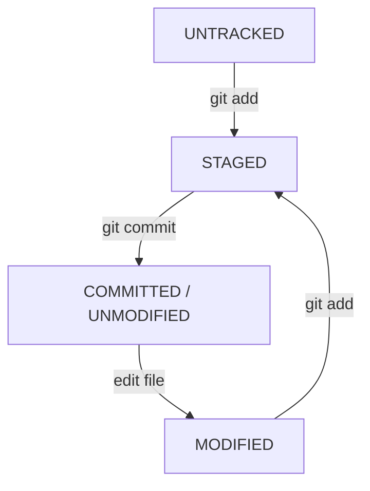

# Part 3: Basic Workflow

> **Level:** 🟢 Beginner ➡ 🔵 Expert
> **Goal:** Master the core add → commit cycle and understand the file lifecycle.

---

## 3.1 The Lifecycle of Files

Every file in your repo is in one of **four states** at any time:

| State | Meaning |
|-------|---------|
| **Untracked** | Git sees the file but has never been told about it before. |
| **Unmodified** | Tracked and unchanged since the last commit. |
| **Modified** | Tracked, but you changed it since the last commit. |
| **Staged** | Modified *and* marked to be included in the next commit. |



### The "Tracked" concept

- **Tracked** files = Git already knows about them (they are in the last snapshot).
- **Untracked** files = brand new; Git is waiting for you to `git add` them.
- The **`.gitignore`** file tells Git to never track certain files (more below).

---

## 3.2 The Four Essential Commands

### `git status` — "What is happening right now?"

```bash
git status
git status --short   # condensed one-line-per-file view
```

Always run this **first** when you are unsure of your repo's state.

### `git add` — "Stage these changes"

```bash
git add file.txt          # one file
git add .                 # all changes in the current folder
git add src/              # everything inside a folder
git add *.md              # all markdown files
```

### `git commit` — "Save a snapshot"

```bash
git commit -m "Your clear, imperative message"
git commit               # opens your editor for a longer message
git commit -am "message" # stage ALL tracked changes AND commit (one step)
```

> ⚠️ **Warning:** `git commit -am` only stages files that are **already tracked**. It will **not** add brand-new untracked files. Use `git add` for those first.

### `git log` — "Show me the history"

```bash
git log                  # full history
git log --oneline        # compact, one line per commit
git log --oneline --graph --all   # visual branch history
```

---

## 3.3 Best-Practice Commit Messages

- Write in the **imperative mood**: "Add feature", not "Added feature".
- Keep the subject **under 50 characters**.
- Use a **blank line + body** for the "why".

```bash
git commit -m "Fix login redirect after password reset"
```

Multi-line message via editor:

```text
Refactor auth module

The old session logic duplicated token validation. Extract it into
a shared helper so both web and mobile clients reuse the same path.
```

---

## 🟢 Beginner Example — Saving a Text File

You are writing a shopping list. Let us walk the full lifecycle.

```bash
# 1. Create the file (untracked)
echo "Apples" > shopping.txt

# 2. What does Git say?
git status        # "Untracked files: shopping.txt"

# 3. Stage it
git add shopping.txt
git status        # "Changes to be committed: shopping.txt"

# 4. Commit it
git commit -m "Add initial shopping list"
git status        # "nothing to commit, working tree clean"

# 5. Edit the file (now it is modified)
echo "Bananas" >> shopping.txt
git status        # "Changes not staged for commit: shopping.txt"

# 6. Stage and commit the change
git add shopping.txt
git commit -m "Add bananas to list"

# 7. View history
git log --oneline
```

That is the whole loop: **edit → add → commit → repeat**. 🎯

---

## 🔵 Expert Example — Selective Staging with `git add -p`

In a real project, you may make **several unrelated changes** in the same file, but you want **separate, focused commits** (a professional habit that makes history reviewable).

Say `auth.js` now contains two fixes: a typo fix and a security check.

```bash
# 1. Stage changes HUNK BY HUNK (p = patch)
git add -p auth.js
```

Git shows you the first hunk and asks what to do:

```text
Stage this hunk? [y,n,q,a,d,s,e,?] ?
```

- `y` → stage this hunk
- `n` → skip this hunk
- `s` → split the hunk into smaller hunks
- `e` → manually edit the hunk (powerful!)
- `q` → quit

```bash
# 2. Commit only the typo fix
git commit -m "Fix typo in error message"

# 3. Stage the remaining hunks
git add -p auth.js
git commit -m "Add input validation for login form"
```

Result: **two clean, focused commits** instead of one messy one.

### Bonus: interactive staging UI

```bash
git add -i     # interactive mode
git gui        # graphical staging tool (if installed)
```

> 💡 **Pro Tip:** Combine selective staging with `git diff --cached` to review *exactly* what you are about to commit:
> ```bash
> git diff            # unstaged changes
> git diff --cached   # staged changes (what the commit will contain)
> git diff HEAD       # everything vs the last commit
> ```

---

## ⚠️ Common Mistakes

- ❌ **Committing `.env` or secret files.** Add them to `.gitignore` **before** the first commit.
- ❌ **`git add .` + `git commit` without reviewing** — you may commit build artifacts or junk.
- ❌ **Vague messages** like `git commit -m "update"`.
- ❌ **Editing after `git add`** — your next commit may miss those edits unless you `git add` again.

### Mini `.gitignore` example

```gitignore
# ignore secrets and junk
.env
node_modules/
*.log
.DS_Store
```

---

## ✅ Key Takeaways

- Files move through **Untracked → Staged → Committed → Modified**.
- **`git add`** stages; **`git commit`** snapshots; **`git status`** informs; **`git log`** shows history.
- **`git add -p`** lets experts build clean, focused commits.
- Review your staged changes with **`git diff --cached`** before committing.

---

## 📍 Next Steps

- ⏭️ Continue to **[Part 4: Branching & Merging](./part-4-branching-and-merging.md)** — Git's superpower.
- 📋 Need a command fast? Open the **[Cheat Sheet](./cheatsheet.md)**.
- 🔄 Want the full workflow at a glance? See the **[Command Sequence](./git-commands-sequence.md)**.
