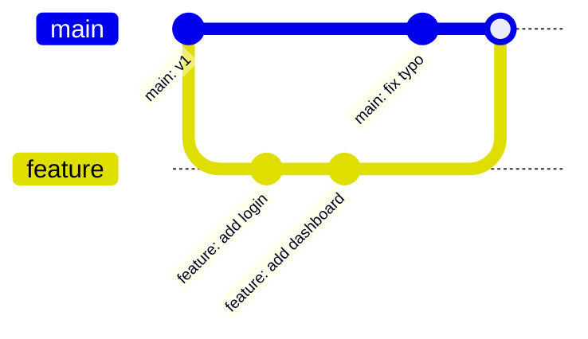

# Part 4: Branching & Merging

> **Level:** 🟢 Beginner ➡ 🔵 Expert
> **Goal:** Learn branches, switching, merging, and (the scary one) conflict resolution.

---

## 4.1 What Are Branches?

A **branch** is a movable pointer to a commit. Think of it as a **parallel universe** of your project — you can experiment without touching the main line.

- The default branch is usually **`main`** (older repos call it `master`).
- Creating a branch is **instant and cheap** — it is just a label.
- Branches are the heart of Git workflows: one branch per feature/bugfix/experiment.



---

## 4.2 Branch Commands

### Create & list branches

```bash
git branch                    # list local branches (* = current)
git branch feature-login      # create a branch (does NOT switch)
git branch -a                 # list local AND remote branches
git branch -d branch-name     # delete a merged branch
```

### Switch branches

```bash
git checkout feature-login    # old style
git switch feature-login      # NEW, clearer style (Git 2.23+)
git switch -c new-branch      # create AND switch in one step
git checkout -b new-branch    # same, old style
```

> 💡 **Pro Tip:** Prefer `git switch` for switching and `git restore` for reverting files — the newer commands are clearer than overloaded `git checkout`.

---

## 4.3 Merging

**Merging** combines the work of one branch into another. It takes changes from a source branch and applies them to your current branch.

```bash
git switch main               # go to the receiving branch
git merge feature-login       # bring feature-login INTO main
```

- **Fast-forward merge:** The target branch hasn't moved → Git simply slides the pointer forward. Clean and linear.
- **Three-way merge:** Both branches moved → Git combines the two histories and creates a **merge commit**.

---

## 4.4 Merge Conflicts 😱

A **conflict** happens when Git cannot automatically merge because **two branches changed the same line(s) differently**.

Git marks the conflicted file so you can resolve it manually:

```text
<<<<<<< HEAD
The version on your current branch
=======
The version on the incoming branch
>>>>>>> feature-login
```

### Conflict resolution workflow

```bash
# 1. See which files are conflicted
git status        # "both modified: index.html"

# 2. Open the file, decide what to keep, remove the <<<< ==== >>>> markers

# 3. Mark it resolved
git add index.html

# 4. Finish the merge
git commit -m "Merge feature-login into main"
```

> 💡 **Pro Tip:** Use visual merge tools to make resolution easier:
> ```bash
> git config --global merge.tool vscode
> git mergetool
> ```

---

## 🟢 Beginner Example — Branch for a New Feature

You are adding a "Dark Mode" toggle to your website. You do **not** want to break the live version, so you use a branch.

```bash
# 1. Make sure you start from a clean main
git switch main
git pull

# 2. Create and switch to a feature branch
git switch -c feature-dark-mode

# 3. Make your changes
git add styles.css
git commit -m "Add dark mode styles"

# 4. Experiment more (it is safe — main is untouched)
git add toggle.js
git commit -m "Wire up dark mode toggle"

# 5. Done? Merge back into main
git switch main
git merge feature-dark-mode

# 6. Clean up the merged branch
git branch -d feature-dark-mode
```

If everything goes sideways, your `main` was never affected. That is the power of branches! 🛡️

---

## 🔵 Expert Example — Merging a Long-Lived Feature Branch (with conflict resolution)

**Scenario:** A senior engineer has been building `feature/payments-v2` for two weeks. Meanwhile, the team merged a big refactor into `main`. It is time to merge — and there **will** be conflicts.

### Step 1: Sync and integrate `main` *into* your feature first

Integrating `main` into your feature regularly keeps the eventual merge small and reviewable.

```bash
git switch feature/payments-v2
git fetch origin
git merge origin/main
```

### Step 2: Resolve a real conflict

```text
CONFLICT (content): Merge conflict in src/billing/invoice.ts
```

Open `invoice.ts` — Git shows:

```text
<<<<<<< HEAD
  const taxRate = 0.08;
=======
  const taxRate = config.getTaxRate(country);
>>>>>>> origin/main
```

Both are valid, but the config-based one is the new system. You keep the incoming version:

```text
  const taxRate = config.getTaxRate(country);
```

Then:

```bash
git add src/billing/invoice.ts
git commit -m "Resolve tax-rate conflict with new config system"
```

> ⚠️ **Warning:** Never leave `<<<<<<<` markers in your code. Resolve **every** conflict before committing.

### Step 3: Merge your feature into main via a **Pull Request** (see Part 6)

Because your branch was kept in sync, the PR merges almost cleanly.

### Step 4: Delete the branch (and remote branch)

```bash
git branch -d feature/payments-v2
git push origin --delete feature/payments-v2
```

> 💡 **Pro Tip:** **Abort** a messy merge at any time:
> ```bash
> git merge --abort
> ```
> Nothing is lost; you are back to the state before the merge started.

---

## ⚠️ Common Mistakes

- ❌ **Committing directly to `main`** in a team — use feature branches + PRs.
- ❌ **Resolving conflicts carelessly** — always test after resolving.
- ❌ **`git branch -d` on an unmerged branch** — Git refuses. If you are sure, `git branch -D` forces it (use with care).
- ❌ **Forgetting to fetch/pull** before merging — you may merge a stale view.

---

## ✅ Key Takeaways

- A **branch** is a lightweight pointer to a commit — your private sandbox.
- **`git switch`** moves between branches; **`git merge`** combines work.
- **Fast-forward** merges stay linear; **three-way** merges create merge commits.
- **Conflicts** are normal — resolve them by editing, `git add`, and committing.

---

## 📍 Next Steps

- ⏭️ Continue to **[Part 5: Introduction to GitHub](./part-5-introduction-to-github.md)** — take your repo online.
- 📋 Need a command fast? Open the **[Cheat Sheet](./cheatsheet.md)**.
- 🔄 Want the full workflow at a glance? See the **[Command Sequence](./git-commands-sequence.md)**.
