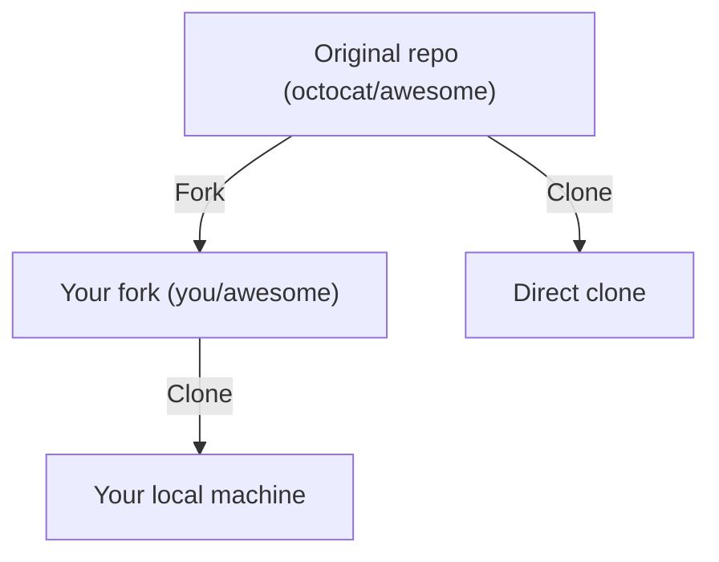

# Part 6: Collaboration Workflows

> **Level:** 🟢 Beginner ➡ 🔵 Expert
> **Goal:** Master forks, Pull Requests, code reviews, and keeping forks in sync.

---

## 6.1 Forking vs Cloning

### Clone 🖨️

- **Copy a repo** directly to your machine.
- You get the code, but **no write access** to the original.
- Good for: working locally on a repo you already have access to.

### Fork 🍴

- **Copy a repo to YOUR GitHub account** (server-side copy).
- You now have your **own remote** that you can push to.
- Good for: contributing to a project you do not own.



> 💡 **Pro Tip:** Use a fork when you do **not** have push access to the original. Use a direct clone when you do (e.g., your team's repo).

---

## 6.2 Pull Requests (PRs) and Code Reviews

A **Pull Request (PR)** is a *proposal* to merge changes from one branch/repo into another. It is where **discussion and review** happen before code lands.

### The PR flow

1. Make a **feature branch**.
2. Commit and **push** it to your fork/remote.
3. Open a **PR** on GitHub from your branch → the target branch.
4. Teammates **review**, comment, and request changes.
5. Automated **CI checks** run on the PR (tests, linting).
6. After approval, **merge** the PR (and delete the branch).

### Review etiquette

- ✅ Small, focused PRs get reviewed faster.
- 📝 Always include a **description** (what and why).
- 🗨️ Respond politely to comments.
- 🔧 Update your PR by pushing new commits to the same branch.

---

## 6.3 Syncing a Fork

Your fork will get **out of date** as the original project moves forward. Sync regularly:

```bash
# Fetch updates from upstream
git fetch upstream

# Move your local main to match upstream
git switch main
git merge upstream/main

# Update your fork on GitHub
git push origin main
```

> ⚠️ **Warning:** Sync your fork **before** starting new work to avoid conflicts.

---

## 🟢 Beginner Example — Opening Your First PR

You want to fix a typo in the docs of an open-source project.

```bash
# 1. Fork the project on GitHub (click "Fork")
# 2. Clone your fork
git clone https://github.com/you/awesome-project.git
cd awesome-project

# 3. Create a feature branch
git switch -c fix-typo-in-readme

# 4. Make your change
git add README.md
git commit -m "docs: fix typo in quick start section"

# 5. Push your branch to your fork
git push -u origin fix-typo-in-readme
```

### 6. Open the PR on GitHub

- GitHub shows a **"Compare & pull request"** button after your push — click it.
- Set **base** = `octocat:main` (original), **compare** = `you:fix-typo-in-readme` (yours).
- Write a short description: *"Fixed the typo in the quick start section."*
- Click **Create pull request**.

🎉 You have contributed to open source! The maintainer will review and merge your PR.

---

## 🔵 Expert Example — CI/CD Integration with PRs

**Scenario:** A senior engineer merges code into `main` **only** via PRs that pass a full CI/CD pipeline. Manual merges are disabled with branch protection.

### GitHub Actions workflow (`.github/workflows/ci.yml`)

```yaml
name: CI

on:
  pull_request:
  push:
    branches: [main]

jobs:
  test:
    runs-on: ubuntu-latest
    steps:
      - uses: actions/checkout@v4
      - uses: actions/setup-node@v4
        with:
          node-version: 20
      - run: npm ci
      - run: npm test
      - run: npm run lint
```

### What happens on every PR

- ✅ CI runs **automatically** on every push to the PR branch.
- 🔴 If tests fail, the PR is **blocked** (branch protection).
- 👥 A **required review** must approve.
- 🔒 The PR **cannot** be merged until everything passes.

### Merge strategies pros use

| Strategy | Effect |
|----------|--------|
| **Merge commit** | Preserves every commit + a merge commit |
| **Squash and merge** | Collapses all commits into **one** clean commit |
| **Rebase and merge** | Replays your commits on top of main, linear history |

> 💡 **Pro Tip:** Use **squash and merge** for feature branches — it keeps `main` history clean and reviewable.

### Keep your PR up to date with main

```bash
git fetch origin
git merge origin/main        # or: git rebase origin/main
git push                    # updates the PR automatically
```

> ⚠️ **Warning:** Avoid force-pushing (`git push --force`) to a shared PR branch. If you must (after a rebase), use `git push --force-with-lease` — it refuses to overwrite changes you have not seen.

---

## ⚠️ Common Mistakes

- ❌ **PRs that touch many files** — hard to review. Keep PRs small.
- ❌ **Merging failing code** — let CI and reviewers protect `main`.
- ❌ **Never syncing your fork** — you end up with huge conflicts later.
- ❌ **Force-pushing to shared branches** — destroys teammates' work.

---

## ✅ Key Takeaways

- **Fork** = copy on your GitHub account; **clone** = copy on your machine.
- **PRs** are the formal way to propose, review, and merge changes.
- **CI/CD** automation gates merges on tests and reviews.
- **Sync your fork** regularly via `fetch` + `merge upstream/main` + `push`.

---

## 📍 Next Steps

- ⏭️ Continue to **[Part 7: Advanced Git](./part-7-advanced-git.md)** — rebase, stash, cherry-pick, reset, revert.
- 📋 Need a command fast? Open the **[Cheat Sheet](./cheatsheet.md)**.
- 🔄 Want the full workflow at a glance? See the **[Command Sequence](./git-commands-sequence.md)**.
