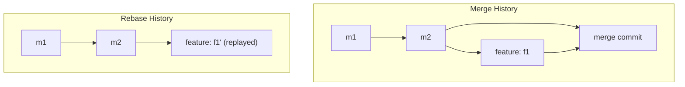

# Part 7: Advanced Git

> **Level:** 🔵 Expert
> **Goal:** Master rebase vs merge, stash, cherry-pick, and undoing changes safely.

---

## 7.1 `git rebase` vs `git merge`

Both integrate one branch's work into another, but with different history results.

### Merge 🤝 — "Preserve the story"

- Creates a **merge commit** connecting both branch histories.
- History keeps its **true, chronological shape** (with branches).

### Rebase 🎯 — "Rewrite the story"

- **Replays** your commits one-by-one **on top of** another branch's tip.
- Produces a **clean, linear** history.



### When to use what

| Situation | Prefer |
|-----------|--------|
| Shared/team branch, PR merge | **Merge** (safe, non-destructive) |
| Personal feature branch cleanup | **Rebase** (linear history) |
| Public `main` | **Never rebase** — it rewrites history others may have |

> ⚠️ **Warning:** **Never rebase commits you have already pushed** to a shared branch. You rewrite history and break everyone's clones. Golden rule: *only rebase your own, local commits.*

```bash
git switch my-feature
git rebase main            # replay my-feature commits on top of main
```

### Interactive rebase

```bash
git rebase -i HEAD~3       # squash, reword, reorder the last 3 commits
```

---

## 7.2 `git stash` — Temporarily set aside work

The **stash** lets you save uncommitted changes, clean your working tree, and come back later.

```bash
git stash                  # save all uncommitted changes
git stash list             # view stashes
git stash pop              # restore most recent stash (and remove it)
git stash apply            # restore WITHOUT removing from stash list
git stash push -m "WIP auth"   # named stash
git stash drop stash@{1}   # delete a specific stash
git stash clear            # delete ALL stashes
```

> 💡 **Pro Tip:** Keep only *short-lived* stashes. They are easy to forget and confusing to teammates.

---

## 7.3 `git cherry-pick` — Pick a single commit

**Cherry-pick** copies **one specific commit** (from anywhere) onto your current branch.

```bash
git cherry-pick a1b2c3d4            # copy commit a1b2c3d4 here
git cherry-pick abc123..def456      # a range of commits
```

Use cases:
- Hotfix a bug that was fixed on another branch.
- Bring a specific feature commit to a release branch.

> ⚠️ **Warning:** A cherry-picked commit is a **copy**, not the original. The original commit still exists where it was.

---

## 7.4 Undoing Changes: `git reset` vs `git revert`

Both undo work — the difference is **where** the undo lives.

### `git revert` ↩️ — Safe undo (public history)

Creates a **NEW commit** that reverses a previous one. History is preserved; the original stays.

```bash
git revert a1b2c3d4        # add a commit that undoes a1b2c3d4
```

✅ Perfect for **published** commits — teammates see a clear "undo" entry.

### `git reset` 🕰️ — Time travel (private history)

Moves the current branch **backward** in time. Only for commits that have **not** been pushed.

| Mode | What it does to files |
|------|------------------------|
| `--soft` | History moves back; changes stay **staged** |
| `--mixed` (default) | History moves back; changes stay **unstaged** |
| `--hard` | History moves back; changes are **discarded** ⚠️ |

```bash
git reset HEAD~1          # un-commit last commit, keep changes (mixed)
git reset --soft HEAD~1   # un-commit, keep changes staged
git reset --hard HEAD~1   # un-commit AND discard changes (dangerous!)
git reset a1b2c3d4         # back to a specific commit
```

> ⚠️ **Warning:** `git reset --hard` **permanently discards** changes. If unsure, use `--soft`/`--mixed`, or `git stash` first.

### Quick decision table

| Situation | Command |
|-----------|---------|
| Undo a commit I already **pushed** | `git revert <sha>` |
| Undo my **last local** commit, keep changes | `git reset --soft HEAD~1` |
| Move local branch back, discard changes | `git reset --hard <sha>` |
| Go back to a *point in time* but keep everything | `git revert` or a branch at old commit |

---

## 🟢 Beginner Example — Stashing Work-in-Progress

You are mid-way through editing `app.js` when your boss asks you to fix a hot bug on `main` **right now**. You are not ready to commit your half-finished work.

```bash
# 1. Save your half-finished work away
git stash

# 2. Verify the working tree is clean
git status        # "nothing to commit, working tree clean"

# 3. Switch and fix the bug
git switch main
git commit -am "hotfix: fix crash on login"
git push

# 4. Come back and restore your WIP
git switch feature-cool-thing
git stash pop
```

Your half-finished work is back exactly where you left it. 😌 No lost edits, no messy commit.

---

## 🔵 Expert Example — Interactive Rebase to Clean Commit History

**Scenario:** A developer made 5 messy commits on a feature branch:

```text
e1a2b3c WIP
d4e5f6a oops fix
a7b8c9d add feature part 1
b1c2d3e add feature part 2
c3d4e5f add feature part 3
```

The team wants **one clean, meaningful commit** before the PR.

```bash
# 1. Interactive rebase of the last 5 commits
git rebase -i HEAD~5
```

Your editor opens:

```text
pick c3d4e5f add feature part 3
pick b1c2d3e add feature part 2
pick a7b8c9d add feature part 1
pick d4e5f6a oops fix
pick e1a2b3c WIP
```

Reorder and squash:

```text
pick c3d4e5f add feature part 3
squash b1c2d3e add feature part 2
squash a7b8c9d add feature part 1
squash d4e5f6a oops fix
squash e1a2b3c WIP
```

Save and exit. Git prompts for the new message:

```text
feat: add video player

- Play/pause controls
- Seek bar with preview
- Keyboard shortcuts
```

Result — **one clean commit**:

```text
9z8y7x6 feat: add video player
```

> 💡 **Pro Tip:** After rebasing a *pushed* branch, you must force-push: `git push --force-with-lease`. Use it only on **your own** feature branch.

---

## ⚠️ Common Mistakes

- ❌ **Rebasing shared/pushed branches** — rewrites history others depend on.
- ❌ **`git reset --hard` without a backup** — permanent data loss.
- ❌ **`git revert` vs `git reset` confusion** — reverting local junk creates noise; resetting pushed commits breaks others.
- ❌ **Cherry-picking to "duplicate" a fix instead of merging properly.**

---

## ✅ Key Takeaways

- **Rebase** = linear history (local only); **merge** = preserved history (shared).
- **Stash** parks uncommitted work temporarily.
- **Cherry-pick** copies a specific commit onto your branch.
- **Revert** for published history; **reset** for private history.

---

## 📍 Next Steps

- ⏭️ Continue to **[Part 8: Git Internals](./part-8-git-internals.md)** — what is inside `.git`.
- 📋 Need a command fast? Open the **[Cheat Sheet](./cheatsheet.md)**.
- 🔄 Want the full workflow at a glance? See the **[Command Sequence](./git-commands-sequence.md)**.
