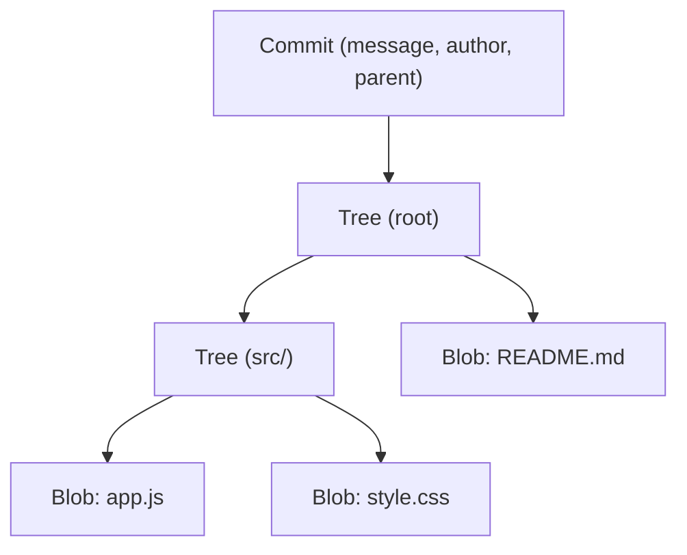
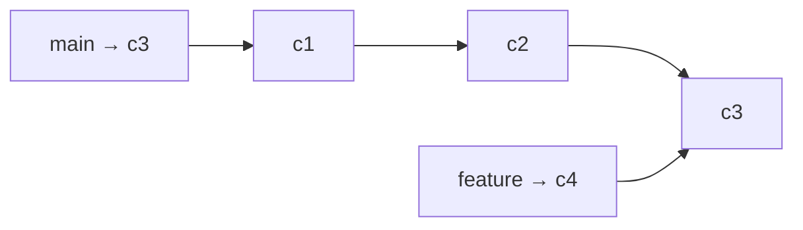

# Part 8: Git Internals

> **Level:** 🔵 Expert
> **Goal:** Understand what Git *actually* is under the hood — `.git`, objects, and recovery.

---

## 8.1 The `.git` Directory Structure

The hidden `.git/` folder is the **entire engine** of your repository. Your working files are just the *view*; `.git` holds the real data.

```text
your-repo/
└── .git/
    ├── HEAD              # which branch am I on?
    ├── config            # repo-specific settings
    ├── description       # used by GitWeb
    ├── index             # the STAGING AREA (a binary index of staged files)
    ├── refs/
    │   ├── heads/        # local branches (pointer files)
    │   └── tags/         # tags
    ├── objects/          # ALL content, stored as immutable objects
    │   ├── blobs/
    │   ├── trees/
    │   ├── commits/
    │   └── packs/        # compressed object bundles
    └── hooks/            # lifecycle scripts (pre-commit, post-merge, ...)
```

> 💡 **Pro Tip:** You will rarely touch `.git` directly, but knowing its structure demystifies Git completely.

---

## 8.2 The Object Model

Git stores everything as **content-addressed objects** in `objects/`. There are four types:

### 1. Blob 📄 — file content

- Stores the **content of a file** (not the filename!).
- Identified by its **SHA-1 hash**.

### 2. Tree 🌳 — directory listing

- Maps filenames → blobs (and sub-trees).
- Represents a **folder snapshot**.

### 3. Commit 🧾 — project snapshot

- Points to: a **tree** (root of the snapshot), **parent commit(s)**, author, committer, and a message.

### 4. Tag 🏷️ — named commit

- A human-friendly name for a specific commit (e.g., `v2.0.0`).



### How hashing works (the magic)

```text
content  +  type  +  size  →  SHA-1 hash  →  used as the object name
```

- Identical content anywhere → **same hash** (content addressing).
- Any change → **different hash** → different object. Immutable history. 🔒

### Explore it yourself

```bash
git cat-file -t <hash>      # what type of object is this?
git cat-file -p <hash>      # pretty-print its content
git ls-tree HEAD            # see the tree at HEAD
```

---

## 8.3 Branches are just pointers

A branch is simply a **file** in `refs/heads/` containing a commit hash.

```bash
cat .git/refs/heads/main
# e.g. a1b2c3d4e5f67890abcdef... (a commit SHA)

git rev-parse main          # the same SHA via a command
```



Both `main` and `feature` point into the same commit chain. **Creating a branch = writing a small pointer file.**

---

## 🟢 Beginner Example — Viewing Logs

You do not need deep internals to *see* the structure — `git log` already shows it beautifully.

```bash
git log --oneline                # compact history
git log --oneline --graph        # visual branch structure
git log --stat                   # files changed per commit
git log -p                       # full diffs per commit
git log --all --oneline --graph  # every branch, including remote refs
```

Output:

```text
* 9z8y7x6 (HEAD -> main) feat: add video player
* 5a4b3c2 fix: typo in settings page
* 1a2b3c4 (origin/main) init: project scaffold
```

> 💡 **Pro Tip:** To see *every* commit including "lost" ones: `git log --all --oneline --graph`. If a commit is not in `--all`, it is a candidate for recovery (see the expert example below).

---

## 🔵 Expert Example — `git fsck` and Recovering Lost Commits

**Scenario:** A developer accidentally ran `git reset --hard` and lost a day of work that was **never pushed**.

### Step 1: Find the "lost" commit

Git's objects are still in `.git/objects/` — nothing is deleted immediately. Use `fsck` (filesystem check):

```bash
git fsck --lost-found
```

Output:

```text
dangling commit 3f2ab4c5d6e7f8a9b0c1d2e3f4a5b6c7d8e9f0a1
dangling blob 99aa88bb77cc66dd55ee44ff33aa22bb11cc00dd
```

A **dangling commit** = a commit no branch points to (our lost work!).

### Step 2: Inspect it

```bash
git show 3f2ab4c5d6e7f8a9b0c1d2e3f4a5b6c7d8e9f0a1
```

Review the message, files, and diff to confirm this is the work you lost.

### Step 3: Recover it

Create a branch at the lost commit — instant resurrection:

```bash
git branch recover-my-work 3f2ab4c5d6e7f8a9b0c1d2e3f4a5b6c7d8e9f0a1
```

Or jump straight there:

```bash
git switch -c recover-my-work 3f2ab4c5d6e7f8a9b0c1d2e3f4a5b6c7d8e9f0a1
```

### Step 4: Merge it back / re-commit

```bash
git switch main
git merge recover-my-work     # bring the work home
git branch -d recover-my-work # clean up after a successful merge
```

> ⚠️ **Warning:** Recovery is not guaranteed forever — **`git gc` (garbage collection)** permanently deletes unreferenced objects. Recover quickly, and push important work early.

### Bonus: reference logs (`reflog`) — your safety net

Git logs every movement of `HEAD` and branches:

```bash
git reflog
```

Output:

```text
9z8y7x6 HEAD@{0}: commit: feat: add video player
5a4b3c2 HEAD@{1}: commit: fix: typo
1a2b3c4 HEAD@{2}: reset: moving to HEAD~1    <-- the "oops" moment
```

Undo that accidental reset:

```bash
git reset --hard 1a2b3c4   # reflog told you the exact SHA to go back to
```

> 💡 **Pro Tip:** The reflog is **local only** and expires (~90 days). It is the fastest recovery tool for "I moved my branch backward" mistakes.

---

## ⚠️ Common Mistakes

- ❌ **Manually editing `.git`** — corrupting objects breaks the repo.
- ❌ **Assuming deleted = gone forever** — Git often can recover, but only if you act before `git gc`.
- ❌ **Forgetting that blobs store *content*, not names** — renaming a file changes a tree, not a blob.
- ❌ **Touching objects with hashes by hand** — use `git cat-file`, `git show`, and `git fsck`.

---

## ✅ Key Takeaways

- **`.git`** contains HEAD, the index (staging area), refs, objects, and hooks.
- Git stores **blobs** (content), **trees** (folders), **commits** (snapshots), and **tags**.
- Branches are just **pointer files** to commits.
- **`git fsck`** and **`git reflog`** are your recovery tools for lost commits.

---

## 🏆 Course Complete!

You have reached the end of **Git & GitHub Mastery**. You went from "what is version control?" to recovering lost commits from Git's raw object database. 🎉

- 📋 Keep the **[Cheat Sheet](./cheatsheet.md)** handy for daily use.
- 🔄 Review the full **[Command Sequence](./git-commands-sequence.md)** whenever you start a new project.
- 🚀 Start back at the **[README](./README.md)** and re-practice any part that felt rushed.

**Practice is the key. Happy committing!**
